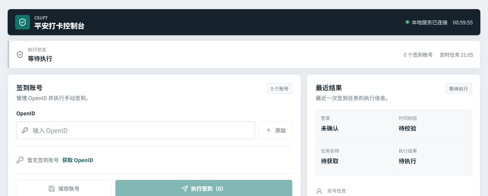
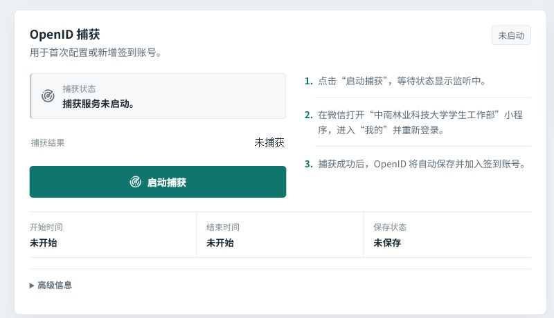
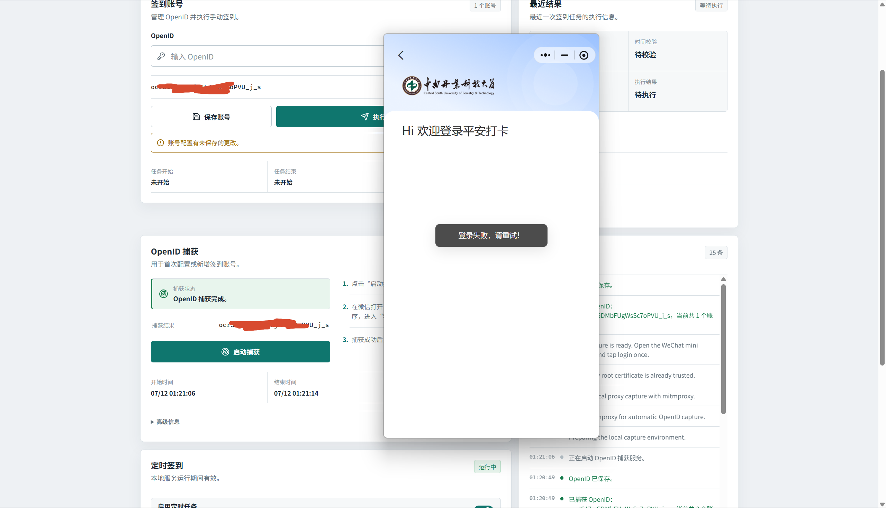
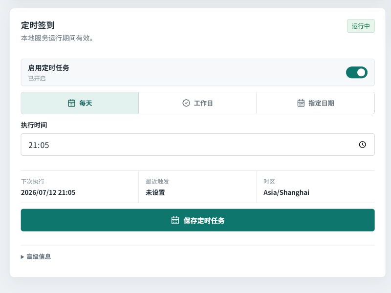

# 中南林业科技大学平安打卡（CSUFT 平安签到 / 平安打卡）

面向中南林业科技大学（CSUFT）的本地签到工具，基于 TypeScript 开发。通过 OpenID 完成签到，并提供本地 Web 控制台。

**常用检索词：** 中南林业科技大学 平安打卡、中南林业科技大学 平安签到、中南林业科技大学 晚打卡、中南林业科技大学平安打卡、CSUFT 平安打卡。

> **项目来源：** 本项目最初 Fork 自 [186526/csuft-unsafe-dorm](https://github.com/186526/csuft-unsafe-dorm)，并在 [HeWhenJay/csuft-unsafe-dorm](https://github.com/HeWhenJay/csuft-unsafe-dorm) 中继续开发。当前版本作为独立仓库发布。项目保留原始作者信息、MIT 许可证和 Git 提交历史。

## 功能

- **多账号签到**：使用单个或多个 OpenID 执行签到。
- **本地控制台**：在网页端管理账号、手动执行签到并查看结果。
- **主题切换**：支持深色与浅色模式，并保存本机界面偏好。
- **OpenID 捕获**：在 Windows 上捕获 OpenID。
- **定时签到**：按每天、工作日或指定日期定时执行。
- **失败重试**：签到失败后在后续时间重新执行。
- **避免重复签到**：同一天成功后跳过重复签到。
- **运行日志**：保存运行日志和定时任务日志。

## 使用前准备

### 基本环境

| 项目 | 要求 |
| --- | --- |
| 操作系统 | 已有 OpenID 时支持 Windows、macOS 和 Linux。OpenID 捕获仅支持 Windows。 |
| Node.js | 使用 Node.js `20.19.x` 或 `22.12+`，推荐 Node.js 24 LTS。 |
| npm | 使用 Node.js 自带的 npm，建议 npm 10 或 11。 |
| JavaScript 依赖 | 在仓库根目录运行 `npm install`（不要使用 `--omit=dev`）。 |
| 浏览器 | 使用现代版 Edge、Chrome 或 Firefox 访问本地控制台。 |
| 网络 | 安装依赖和执行签到时需要网络。 |
| 文件权限 | 确保仓库目录可写。程序需要在此目录保存 `.env`、`.codex-tools/`、配置文件和日志。 |

### OpenID 捕获环境

OpenID 捕获需要以下环境：

- **Windows PowerShell**。
- **系统权限**：当前用户的系统代理和证书库权限。
- **电脑版微信**。
- **微信小程序**：微信中的“中南林业科技大学学生工作部”小程序。
- **Python / mitmproxy**：PATH 中的 `mitmdump`，或可用的标准 CPython 3.12+。找不到时，程序会将 mitmproxy 安装到 `.codex-tools/mitmproxy/venv`。
- **Git**：仅在启用 WMPFDebugger 备用方案时需要。

### 本地端口

| 端口 | 用途 |
| --- | --- |
| `3001` | 后端 API 和本地控制台。 |
| `4173` | Vite 开发服务器。`npm run dev` 会使用此端口。 |
| `8866` | mitmproxy 本地代理。用于捕获 OpenID。 |
| `62000` | WMPFDebugger WebSocket。仅备用捕获方案使用。 |

启动前，请确认所需端口没有被其他程序占用。

### 捕获安全说明

首次捕获 OpenID 时，程序会执行以下操作：

1. 将 mitmproxy CA 证书安装到当前用户的根证书库。
2. 将当前用户的系统代理临时设置为 `127.0.0.1:8866`。
3. 捕获结束后，程序会恢复原代理设置。

> [!IMPORTANT]
> 请只在你信任的 Windows 设备上执行捕获。捕获过程中不要关闭控制台或终端窗口。

## 快速开始

### 1. 安装依赖

在项目根目录运行：

```bash
npm install
```

安装过程会同时安装 `web/` 目录的前端依赖。

### 2. 配置 OpenID

在项目根目录创建 `.env` 文件：

```env
openid=你的openid
```

配置多个账号时，用英文逗号分隔：

```env
openid=openid_1,openid_2
```

没有 OpenID 时，先启动本地控制台，再使用“OpenID 捕获”功能。

### 3. 启动本地控制台

运行：

```bash
npm run dev
```

启动成功后，在浏览器打开：

```text
http://127.0.0.1:3001
```

控制台提供以下功能：

- 保存和管理 OpenID。
- 手动执行签到。
- 捕获 OpenID。
- 配置定时签到。
- 查看最近结果和运行日志。



### 4. 捕获 OpenID

按以下步骤操作：

1. 在控制台点击“启动捕获”。
2. 等待页面显示“监听中”。
3. 在 Windows 微信中打开“中南林业科技大学学生工作部”小程序。
4. 进入“我的”并重新登录。
5. 等待控制台显示捕获结果。

捕获成功后，程序会自动保存 OpenID，并将它加入签到账号。

第一次捕获可能需要安装 mitmproxy。安装时间取决于网络速度。



下面的示例显示了控制台成功捕获并保存 OpenID 的结果。示例中的账号标识已遮挡。



如果 mitmproxy 无法使用，且需要使用 WMPFDebugger，请在 `.env` 中设置：

```env
ENABLE_WMPF_DEBUGGER_FALLBACK=1
```

备用方案说明见 [WMPFDebugger 备用捕获说明](./docs/openid.md)。

### 5. 执行签到

确认账号正确后，在控制台点击“执行签到”。

控制台会显示以下信息：

- 登录结果。
- 签到时间窗口。
- 任务名称。
- 当前签到状态。
- 运行日志。

也可以使用命令行执行：

```bash
npm run script
```

### 6. 配置定时签到

在控制台的“定时签到”区域完成以下操作：

1. 选择“每天”“工作日”或“指定日期”。
2. 设置执行时间。
3. 选择“保存定时任务”。

程序会将配置保存到 `.codex-tools/schedule.json`。本地后端使用 `node-cron` 触发任务，时区固定为 `Asia/Shanghai`。

> [!NOTE]
> 定时任务依赖本地后端进程。运行 `npm run dev` 时任务有效。关闭该进程后，定时任务停止。

程序会跳过以下情况：

- 今天不符合已选的日期规则。
- 今天已经成功签到。

签到失败的任务可以在后续触发时间再次执行。



## 常用命令

| 命令 | 用途 |
| --- | --- |
| `npm run dev` | 同时启动后端 API 和 Vite 前端。 |
| `npm run build` | 编译 TypeScript 后端。 |
| `npm run build:web` | 构建前端静态文件。 |
| `npm run script` | 使用 `.env` 中的 OpenID 手动签到。 |
| `npm run script:schedule-runner` | 执行一次定时签到入口。 |

## 日志

### 计划任务总日志

Windows 计划任务包装脚本会将输出写入：

```text
scheduled-task.log
```

此文件可用于确认计划任务是否被系统触发。

### 自动签到结果日志

自动签到结果保存在以下目录：

```text
总日志/年份日志/月日志/第X周日志/
```

程序会按日志生成时间自动创建目录。规则如下：

- 年目录：`2026年日志`。
- 月目录：`6月日志`。
- 月内 1–7 日：`第1周日志`。
- 月内 8–14 日：`第2周日志`。
- 后续日期按相同规则计算。

文件名格式如下：

```text
年-月-日-时-分-秒+结果.log
```

其中 `结果` 可以是 `成功`、`失败` 或 `跳过`。

示例目录：

```text
总日志/2026年日志/6月日志/第2周日志/
```

OpenID 捕获工具的运行文件保存在：

```text
.codex-tools/
```

## 常见问题

### 没有可用的 OpenID

检查 `.env` 中是否存在 `openid`。也可以在控制台使用“OpenID 捕获”。

### OpenID 捕获失败

按以下顺序检查：

1. 确认设备使用 Windows。
2. 确认电脑版微信正在运行。
3. 确认已打开目标小程序。
4. 确认已进入“我的”并重新登录。
5. 查看控制台中的捕获状态和错误信息。

如果 mitmproxy 安装失败，请检查 Python、网络和当前用户的文件权限。需要时再启用 WMPFDebugger 备用方案。

### 定时签到没有执行

按以下顺序检查：

1. 确认 `npm run dev` 仍在运行。
2. 确认定时任务已启用。
3. 确认当前日期符合任务规则。
4. 确认今天没有成功签到记录。
5. 检查 `scheduled-task.log` 和 `总日志/` 中的日志。

### 签到失败

检查 OpenID、网络连接和当前签到时间窗口。然后查看控制台结果和日志中的错误信息。

## 相关文档

- [命令行脚本与外部定时任务](./docs/running.md)
- [WMPFDebugger 备用捕获说明](./docs/openid.md)
- [请求签名机制分析](https://github.com/Feather-P/ahut-dorm-sign/blob/master/docs/%E8%AF%B7%E6%B1%82%E7%AD%BE%E5%90%8D%E6%9C%BA%E5%88%B6%E5%88%86%E6%9E%90.md)

## 使用与许可

本仓库仅供学习和研究使用。请遵守适用的法律和学校规定。

使用者需要自行承担使用本项目的后果和责任。

项目使用 [MIT License](./LICENSE)。
